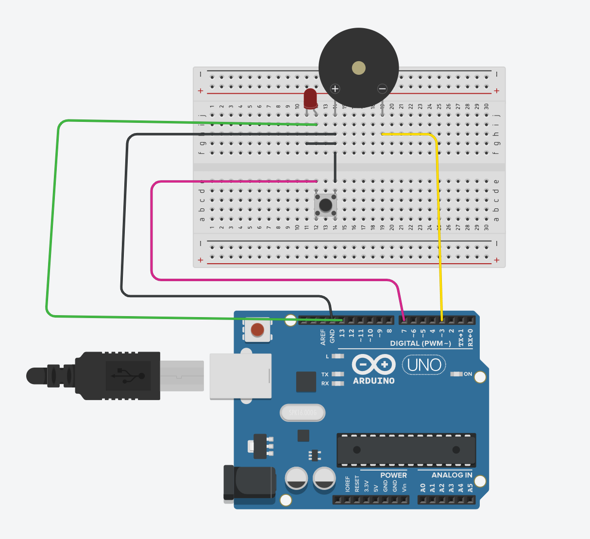
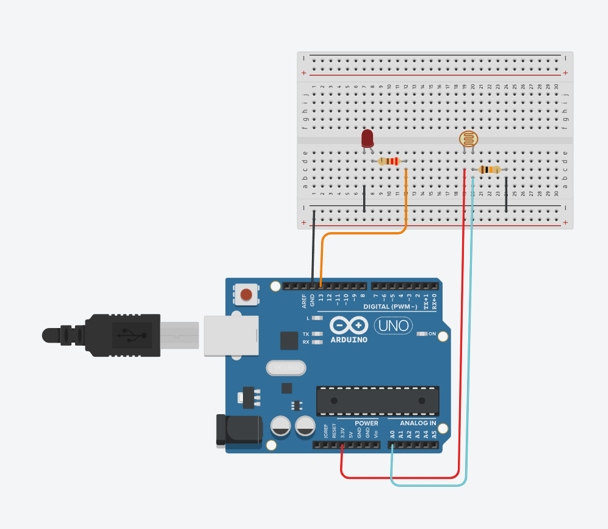
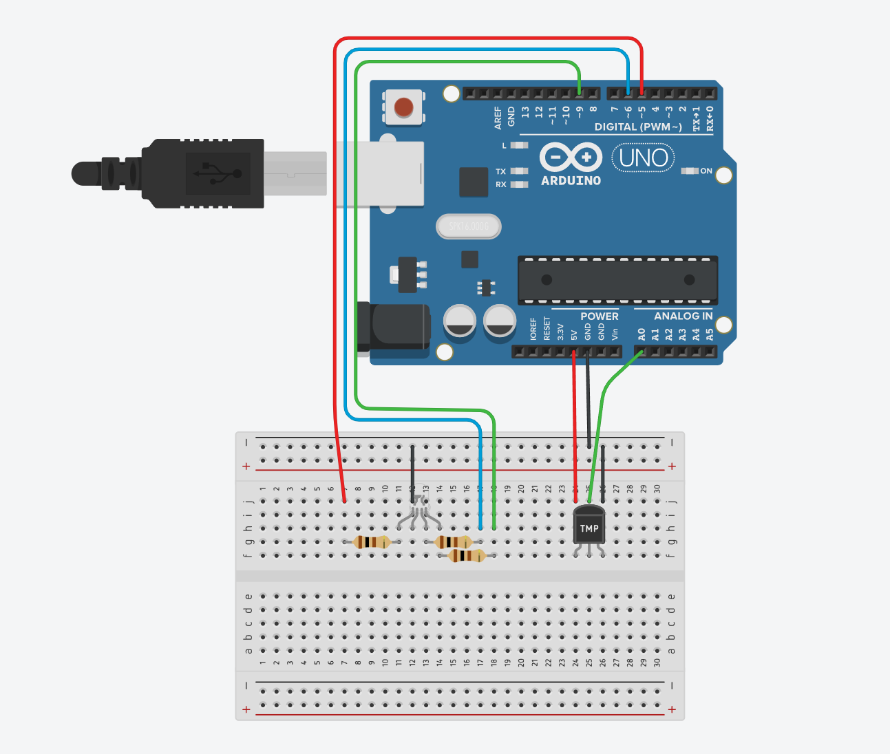

# Επίπεδο 1: Σενάρια για αρχάριους

Τρία σενάρια για τα πρώτα βήματα με Arduino Uno και breadboard. Σχεδιάστηκαν στο [Tinkercad Circuits](https://www.tinkercad.com/circuits), οπότε μπορείς να τα δοκιμάσεις και χωρίς πραγματικό υλικό.

Τα σενάρια αναπτύχθηκαν σε συνεργασία με τον καθηγητή Άγγελο Μιχάλα.

---

## 1. Button-Buzzer

Όσο πατάς το κουμπί, ηχεί το buzzer και ανάβει το LED. Στο Serial Monitor εμφανίζεται η κατάσταση του κουμπιού.

| Εξάρτημα | Pin |
|---|---|
| Κουμπί | 7 (`INPUT_PULLUP`) |
| Buzzer | 3 |
| LED | 13 |

**Έννοιες:** `digitalRead`, `digitalWrite`, εσωτερική αντίσταση pull-up (πατημένο = `LOW`).

---

## 2. PhotoResistor-and-Led

Ένα «φωτάκι νυκτός»: όταν πέφτει το φως, ανάβει το LED. Η τιμή της φωτοαντίστασης εμφανίζεται κάθε δευτερόλεπτο στο Serial Monitor.

| Εξάρτημα | Pin |
|---|---|
| Φωτοαντίσταση | A0 |
| LED | 13 |

**Έννοιες:** `analogRead` (τιμές 0–1023), κατώφλι απόφασης (εδώ `600`, μπορείς να το αλλάξεις).

---

## 3. RGB-Led-With-Temperature-Sensor

Το RGB LED αλλάζει χρώμα ανάλογα με τη θερμοκρασία: **μπλε** κάτω από 20 °C, **πράσινο** από 20 έως 28 °C και **κόκκινο** πάνω από 28 °C.

| Εξάρτημα | Pin |
|---|---|
| Αισθητήρας θερμοκρασίας | A0 |
| RGB LED – κόκκινο / πράσινο / μπλε | 5 / 9 / 6 |

**Έννοιες:** μετατροπή τιμής ADC σε mV και σε °C, αλυσίδα `if / else if`.

> **Δοκίμασε:** τι χρώμα δείχνει το LED όταν η θερμοκρασία είναι ακριβώς 28 °C; Γιατί; Πώς θα το διόρθωνες;

